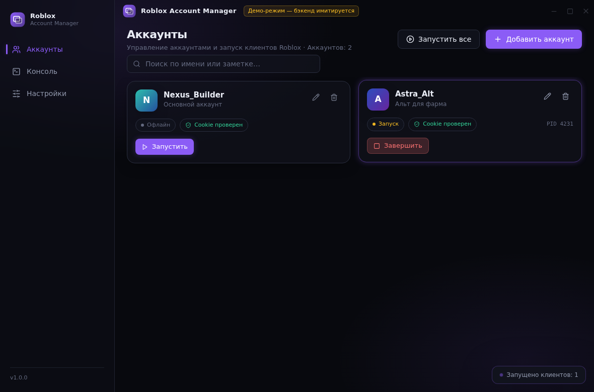
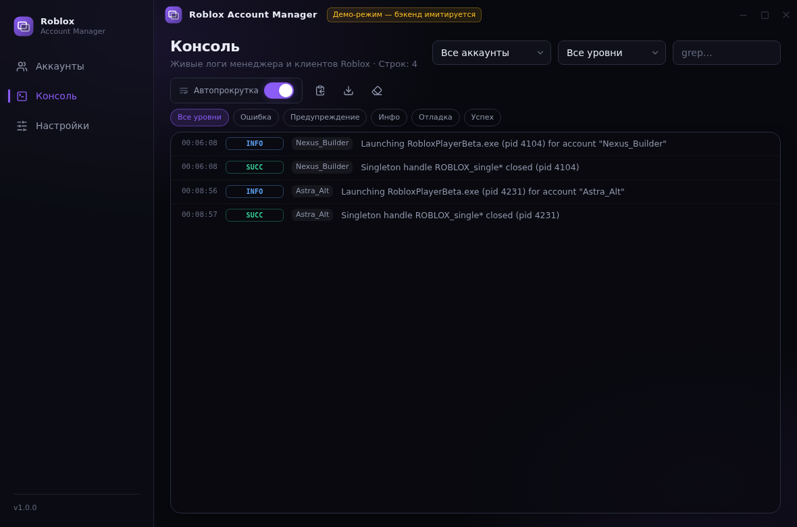
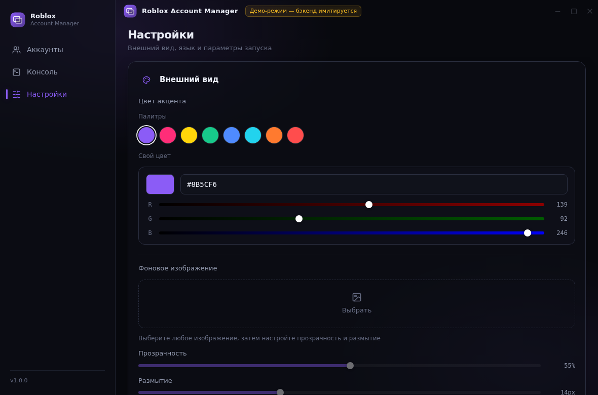
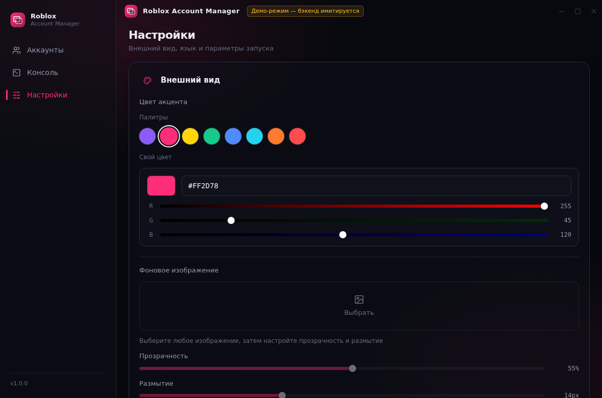

# Roblox Account Manager

Десктопный менеджер аккаунтов Roblox для Windows: несколько клиентов одновременно, шифрованное хранение cookie, живая консоль логов и настраиваемый премиальный интерфейс (тёмная тема, Acrylic-подложка, кастомный фон с прозрачностью и размытием, палитры акцентов).

Собран на **Tauri 2 (Rust) + React + TypeScript + Tailwind CSS**.

| Аккаунты | Консоль |
| --- | --- |
|  |  |

| Настройки | Кастомизация |
| --- | --- |
|  |  |

Больше скриншотов (модалка добавления, украинская локализация, секция запуска) — в [`docs/screenshots/`](docs/screenshots).

---

## Возможности

- **Мульти-инстанс лаунчер.** Запуск любого числа клиентов `RobloxPlayerBeta.exe` одновременно. Обход блокировки выполняется закрытием синглтон-хэндла (`ROBLOX_single*` Event/Mutant) в каждом клиенте через перечисление таблицы хэндлов (`NtQuerySystemInformation` + `DuplicateHandle`). Файлы Roblox не изменяются, DLL не внедряются.
- **Менеджер аккаунтов.** Cookie `.ROBLOSECURITY` хранится шифрованной через **Windows DPAPI** (область CurrentUser) — данные нельзя расшифровать на другой машине или под другим пользователем. При добавлении аккаунта cookie проверяется через официальный API (`users.roblox.com`): подтягиваются имя, ID и аватар.
- **Статусы.** Локальный трекинг процессов (запуск / в меню / в игре — по заголовку окна) плюс опрос presence-статусов через `presence.roblox.com`.
- **Изоляция данных клиента.** Опционально каждый аккаунт получает собственную папку данных клиента (подмена `LOCALAPPDATA` при запуске) — настройки и сессии не конфликтуют между инстансами.
- **Консоль и логи.** Все события менеджера и клиентов с цветовой кодировкой (Error / Warning / Info / Debug / Success), фильтрами по аккаунту, уровню и тексту, автопрокруткой, копированием и экспортом в `.log`.
- **Кастомизация.** 8 готовых палитр (Violet Nebula, Neon Pink, Cyberpunk Yellow, Dark Emerald и др.) + полноценный color picker (HEX/RGB), фоновое изображение с регулировкой прозрачности и силы размытия, плавные анимации, Acrylic-подложка окна.
- **Локализация.** Английский, русский, украинский — переключение на лету без перезапуска.
- **Только векторные иконки** (Lucide), без эмодзи и символьных заглушек.

## Технологии

| Слой | Стек |
| --- | --- |
| Оболочка | Tauri 2 (Rust, WebView2) |
| Фронтенд | React 18, TypeScript, Tailwind CSS 3, zustand, lucide-react |
| Бэкенд | Rust: DPAPI (crypt32), NtQuerySystemInformation/DuplicateHandle (ntdll), ureq (Roblox API), rfd (диалоги) |
| Хранение | `%APPDATA%\com.rbxacc.manager\config.json` (атомарная запись) |

## Структура проекта

```
roblox-account-manager/
├── src/                     # Фронтенд (React + TS)
│   ├── lib/                 # bridge (Tauri + демо-мок), store (zustand), i18n, тема
│   ├── components/          # UI-кит, TitleBar, Sidebar, карточки, модалки
│   └── pages/               # Аккаунты / Консоль / Настройки
├── src-tauri/               # Бэкенд (Rust)
│   ├── src/
│   │   ├── main.rs          # Точка входа Tauri
│   │   ├── commands.rs      # Tauri-команды (CRUD, запуск, настройки)
│   │   ├── winproc.rs       # Процессы Windows: запуск, обход синглтона, трекинг
│   │   ├── crypto.rs        # DPAPI-шифрование cookie
│   │   ├── roblox.rs        # Roblox API: валидация cookie, аватар, presence
│   │   ├── monitor.rs       # Фоновый монитор инстансов
│   │   └── store.rs         # Конфигурация JSON
│   ├── capabilities/        # Разрешения Tauri v2
│   └── icons/               # Иконки (генерируются scripts/gen_icons.py)
├── scripts/
│   ├── build.ps1            # Сборка под Windows -> NSIS + portable zip
│   ├── build.sh             # Сборка под Linux/macOS + zip исходников
│   └── gen_icons.py         # Регенерация иконок (Python + Pillow)
├── .github/workflows/       # CI: сборка установщика Windows на GitHub Actions
└── docs/screenshots/        # Скриншоты
```

## Требования

- Windows 10/11 (WebView2 входит в состав системы; при отсутствии установится автоматически).
- Node.js 18+ (https://nodejs.org).
- Rust stable с тулчейном MSVC (https://rustup.rs).

## Запуск в режиме разработки

```bash
npm install
npm run tauri dev
```

Без установленного Rust можно посмотреть интерфейс: `npm run dev` открывает UI в браузере с имитацией бэкенда (демо-режим, в заголовке окна есть плашка).

## Сборка релиза

### Windows (основной сценарий)

```powershell
powershell -ExecutionPolicy Bypass -File scripts\build.ps1
```

Скрипт установит зависимости, соберёт приложение и сложит артефакты в папку `release\`:

- NSIS-установщик (`...-setup.exe`);
- `RobloxAccountManager-portable.zip` (portable-версия одним exe).

Эквивалент вручную: `npm run tauri build` (артефакты в `src-tauri\target\release\bundle\`).

### Без локальной сборки — через GitHub Actions

Загрузите проект в репозиторий GitHub и запустите workflow **Build Windows installer** (вкладка Actions -> Run workflow). Готовые exe и zip появятся в артефактах сборки.

## Как получить cookie .ROBLOSECURITY

1. Войдите на https://www.roblox.com в браузере.
2. Нажмите `F12` -> вкладка **Application** (Edge/Chrome) или **Storage** (Firefox).
3. **Cookies** -> `https://www.roblox.com` -> скопируйте значение cookie **`.ROBLOSECURITY`**.
4. Вставьте его в модалку «Добавить аккаунт». Cookie проверяется автоматически и никуда не отправляется, кроме официальных API Roblox при валидации и presence-опросе.

Никогда не передавайте этот cookie никому — он равносилен паролю от аккаунта.

## Использование

- **Запуск клиента** — кнопка на карточке аккаунта; **«Запустить все»** запускает аккаунты последовательно с настраиваемой задержкой.
- **Остановка** — кнопка «Завершить» на карточке (с подтверждением) или удаление аккаунта останавливает его клиент.
- **Консоль** — фильтры по аккаунту и уровню, поиск, автопрокрутка, экспорт логов в файл.
- **Настройки** — цвет акцента (палитры + свой цвет), фоновое изображение (прозрачность/размытие), язык интерфейса, путь к клиенту, задержка между запусками, изоляция данных, обход синглтон-хэндлов.

## Как это работает (мульти-инстанс)

Клиент Roblox при старте создаёт именованный синглтон-объект (`ROBLOX_singletonMutex` / `ROBLOX_singletonEvent` — в разных версиях клиента по-разному). Каждый следующий клиент видит «уже существует» и закрывается. Менеджер перечисляет таблицу хэндлов всех процессов `RobloxPlayerBeta.exe` (`NtQuerySystemInformation(SystemExtendedHandleInformation)`), находит Event/Mutant с именем `*roblox_single*` и закрывает хэндл в чужом процессе (`DuplicateHandle` с `DUPLICATE_CLOSE_SOURCE`). После этого новые клиенты создают собственный синглтон без конфликта. Вмешательства в память и файлы Roblox нет.

Если система запрещает открытие чужого процесса (редкие жёсткие политики), запустите менеджер от администратора — перечисление хэндлов получит нужный доступ.

## Устранение неполадок

| Симптом | Решение |
| --- | --- |
| «RobloxPlayerBeta.exe не найден» | Укажите путь в Настройках или нажмите «Найти» (клиент обычно в `%LOCALAPPDATA%\Roblox\Versions\version-*\`). |
| Второй клиент сразу закрывается | Убедитесь, что включено «Закрывать синглтон-хэндлы Roblox» и перезапустите оба клиента через менеджер (клиенты, запущенные вне менеджера, нужно закрыть). |
| Клиент запускается, но без входа в аккаунт | Включите «Изолировать данные клиента по аккаунту» и один раз войдите в аккаунт в окне этого клиента — сессия сохранится в его собственной папке. |
| Windows SmartScreen предупреждает о запуске | Файл собран локально без подписи: «Подробнее» -> «Выполнить в любом случае». |
| Проверка cookie всегда неуспешна | Проверьте сеть/прокси; cookie мог быть отозван («Выйти из всех других сессий» в настройках аккаунта Roblox) — получите новый. |

## Безопасность и приватность

- Cookie шифруется DPAPI и хранится только локально; в логи он не пишется никогда.
- Единственные сетевые запросы — официальные API Roblox (`users.roblox.com`, `thumbnails.roblox.com`, `presence.roblox.com`) для валидации и статусов.

## Дисклеймер

Приложение неофициальное и не связано с Roblox Corporation. Запуск нескольких клиентов может рассматриваться как нарушение условий использования Roblox — используйте на свой риск. Лицензия кода — MIT (см. [LICENSE](LICENSE)).
